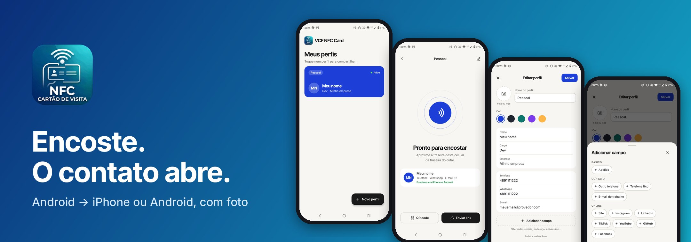
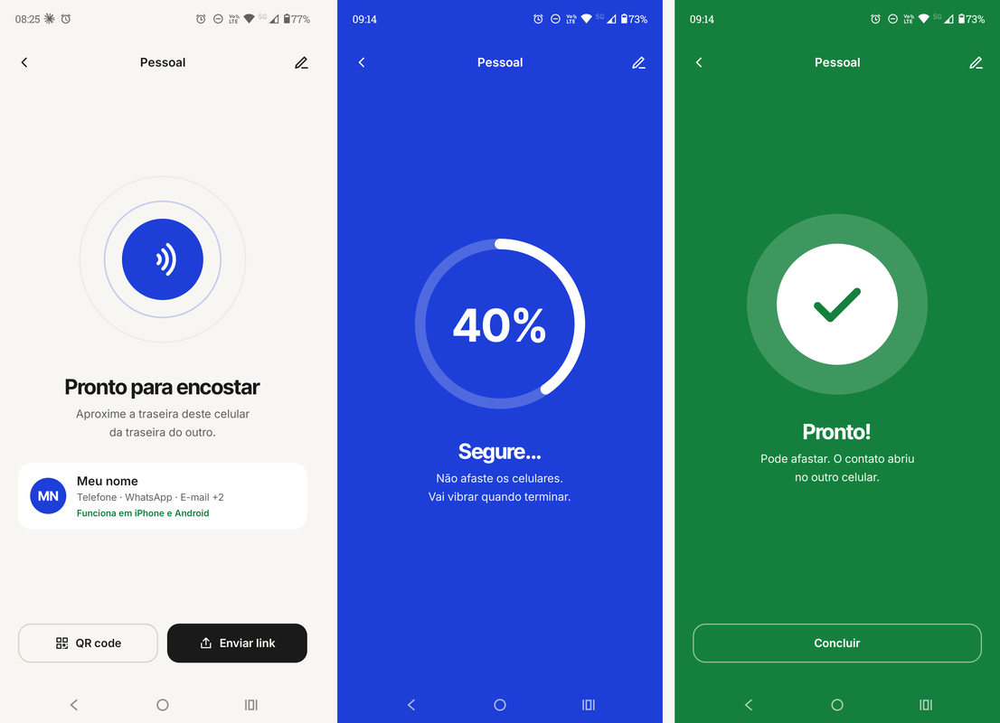
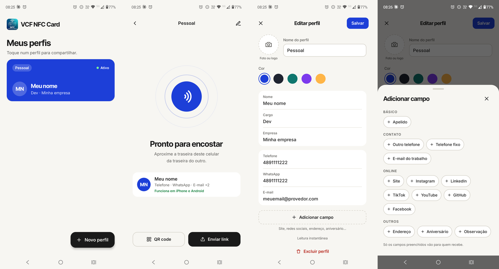

# VCF NFC Card



Cartão de visita digital por **NFC**: encoste o celular Android no do outro (iPhone ou Android) e o contato abre na hora, **com foto**, pronto para salvar na agenda.

📥 **Baixar o APK:** [vcf-nfc-card.apk](https://github.com/rodrigovinigomes2023/vcf-nfc-card/releases/latest)

## Como funciona

```
 Android (este app)                 iPhone / Android (quem recebe)
 ┌──────────────────┐   NFC    ┌──────────────────────────────────┐
 │ finge ser uma    │ ───────▶ │ lê um link:                      │
 │ etiqueta NFC     │          │ cartao-nfc-nine.vercel.app/v#... │
 │ (HCE, Type 4)    │          │                                  │
 └──────────────────┘          │ a página (fixa) lê os dados que  │
                               │ vêm depois do # e monta o vCard  │
                               └──────────────────────────────────┘
```

- O app usa **Host Card Emulation** para se passar por uma etiqueta **NFC Forum Type 4** com um registro NDEF de link.
- O iPhone só reage sozinho (sem app) a **links** — por isso o contato vai como link, e não como arquivo `.vcf` direto.
- **Privacidade:** nome, telefone, foto etc. vão **depois do `#`** do link. O navegador nunca envia essa parte ao servidor — a página é estática e o servidor não recebe nem guarda nenhum dado.
- **Foto:** recortada, reduzida e comprimida para ~6 KB (JPEG em base64url) e enviada dentro do próprio link. A página coloca a foto no vCard (`PHOTO`), então o contato é salvo com avatar.

### Tempo de leitura (medido num moto g54 + iPhone)

O iPhone lê a etiqueta em pedaços de 240 bytes, ~50 ms cada:

| Conteúdo | Tamanho do link | Tempo encostado |
|---|---|---|
| Só texto | ~200 caracteres | instantâneo |
| Com foto de 5 KB | ~6,6 mil | 1,6 s |
| Com foto de 10 KB | ~13 mil | 3,1 s |

Por isso a tela mostra o **progresso real da leitura** e **vibra** quando termina — e avisa se os celulares se afastaram cedo.

### Durante a leitura



## Recursos



- Vários **perfis** (pessoal, trabalho, loja…), cada um com cor e foto/logo
- Campos: nome, cargo, empresa, telefones, WhatsApp, e-mails, site, Instagram, LinkedIn, TikTok, YouTube, GitHub, Facebook, endereço, aniversário, observação
- **QR code** para quem não tem NFC (sem a foto, que não cabe num QR)
- **Enviar link** por WhatsApp e outros apps
- Página de quem recebe com botões (ligar, WhatsApp, e-mail, mapa…) e **Salvar contato**

## Estrutura

| Caminho | O quê |
|---|---|
| `src/br/gomes/nfcvcard/Hce.java` | Emulação da etiqueta NFC (APDUs SELECT / READ BINARY) e aviso de progresso |
| `src/br/gomes/nfcvcard/Perfis.java` | Perfis, campos e montagem do link |
| `src/br/gomes/nfcvcard/Main.java` | Telas (sem XML de layout, tudo em código) |
| `src/br/gomes/nfcvcard/Desenho.java` | Ícones e o círculo de progresso |
| `web/v.html` | Página de quem recebe (estática) |
| `web/api/c.js` | Versão 1, que gerava o vCard no servidor (mantida por compatibilidade) |

## Compilar

Sem Gradle e sem Android Studio — só o SDK de linha de comando:

```bash
sdkmanager "platforms;android-34" "build-tools;34.0.0"
./build.sh          # gera vcf-nfc-card.apk
```

Requer JDK 17 (`javac` do 21 gera classes que o `d8` 34 não aceita). A chave de assinatura fica fora do repositório (`CHAVE=/caminho/da/chave.jks ./build.sh`).

## Feito com IA

Projeto feito por **Rodrigo Gomes** em parceria com o **Claude** (Anthropic): eu defini o produto, decidi o visual e testei nos aparelhos; a IA escreveu o código comigo, passo a passo. Do primeiro APK ao app com perfis e foto: **1 dia**.

## Créditos

- Fontes [Inter e Inter Tight](https://github.com/rsms/inter) — SIL Open Font License 1.1 (`assets/fontes/OFL.txt`)
- Gerador de QR code: [Nayuki QR-Code-generator](https://github.com/nayuki/QR-Code-generator) — MIT

## Licença

[GPL-3.0](LICENSE) © 2026 Rodrigo Gomes. Inclui [QR Code generator](https://www.nayuki.io/page/qr-code-generator-library) de Project Nayuki (MIT) e as fontes Inter e Inter Tight (SIL Open Font License, ver `assets/fontes/OFL.txt`).
